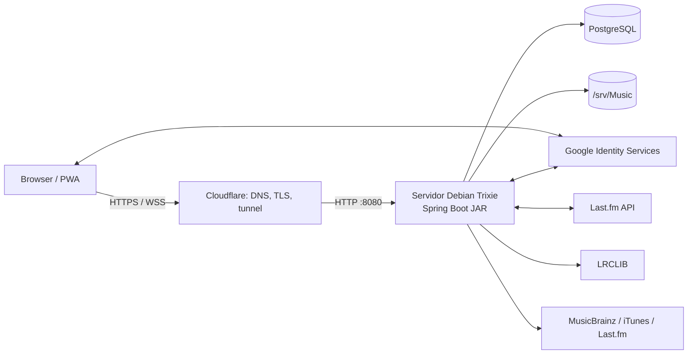
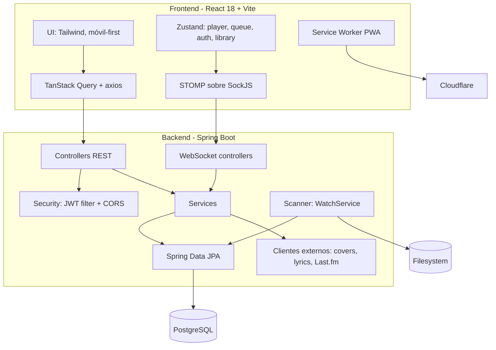
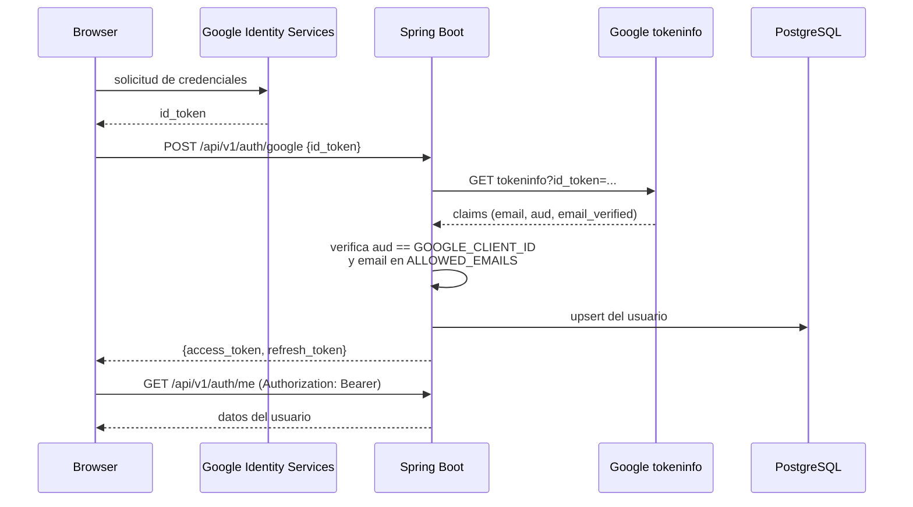
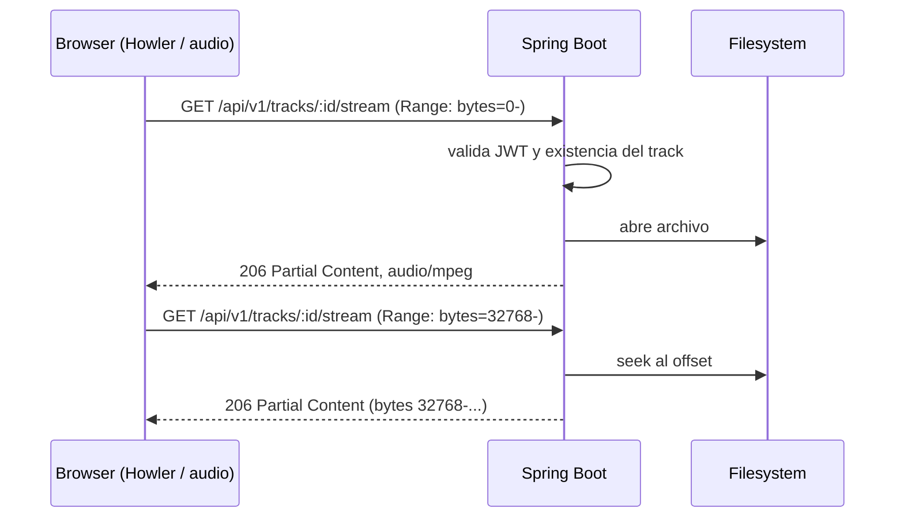
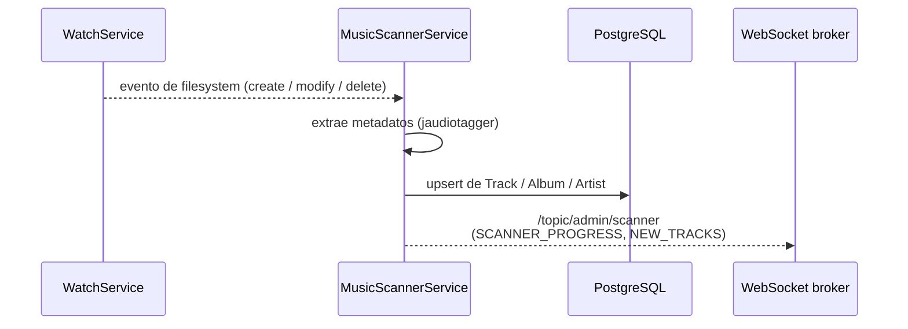
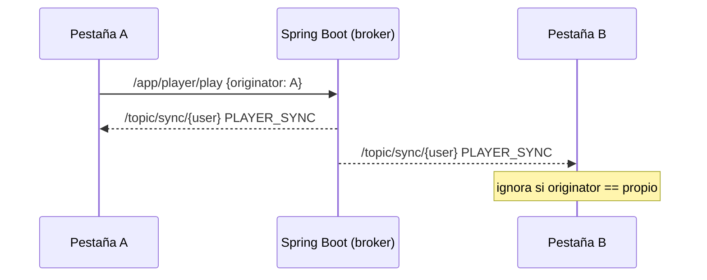
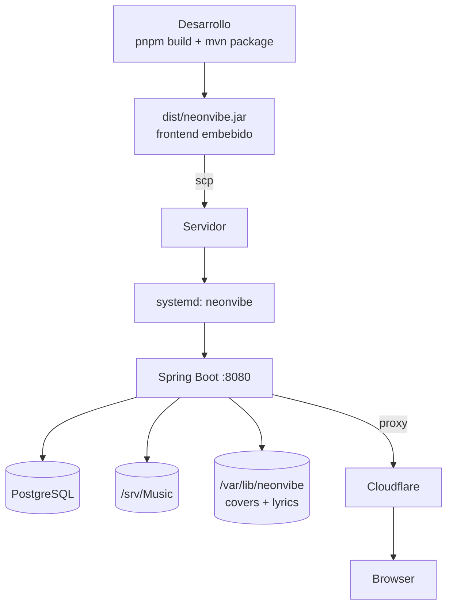

# Arquitectura — NeonVibe

> Documento de arquitectura orientado a personas. Define los componentes, los
> flujos clave y las decisiones de diseño del sistema. El contexto operativo para
> agentes de código vive en `AGENTS.md`.

## 1. Resumen

NeonVibe es un servidor de música personal self-hosted. Consiste en un backend
Spring Boot (Java 21) que sirve una API REST JSON, un frontend React servido como
recurso estático embebido en el mismo JAR, y un canal de tiempo real STOMP sobre
WebSocket. Se ejecuta como un único proceso en un servidor Debian Trixie
bare-metal, detrás de Cloudflare, contra PostgreSQL.

La biblioteca de audio se lee directamente del filesystem (`/srv/Music`); no hay
copia permanente. Opcionalmente se generan **derivados AAC cacheados on-demand**
(quality selector) en un directorio aparte, sin tocar los originales.

## 2. Contexto del sistema



- El navegador habla únicamente con Cloudflare; el servidor no expone otros
  puertos a Internet.
- El backend valida los `id_token` de Google contra `tokeninfo`; no usa
  `spring-security-oauth2-client` para el login.
- La música se sirve por HTTP Range requests; el frontend hace seek sobre el
  archivo sin transcodificación.

## 3. Componentes



Módulos backend (`com.neonvibe.*`):

| Paquete | Responsabilidad |
|---|---|
| `controller` | Endpoints REST bajo `/api/v1` |
| `service` | Lógica de negocio (auth, librería, cola, radio, ...) |
| `repository` | Acceso a datos Spring Data JPA |
| `security` | `JwtAuthenticationFilter`, emisión/validación de JWT |
| `scanner` | WatchService + extracción de metadatos (jaudiotagger) + ingesta de subidas (`IngestService`) y escritura de tags (`AudioTagWriter`) |
| `websocket` | `@MessageMapping` de reproductor/cola y bridge de scanner |
| `transcode` | Transcodificación AAC on-demand (FFmpeg) con caché LRU |
| `push` | Notificaciones nativas Web Push (VAPID) |
| `stats` | Enums de rango/bucket/tipo para las estadísticas |
| `config` | Seguridad, CORS, WebSocket (STOMP), Jackson |
| `infra` | Clientes HTTP: iTunes, MusicBrainz, Last.fm, LRCLIB |
| `dto`, `domain`, `mapper` | Contratos de API, entidades JPA, mapeo |

## 4. Autenticación (Google + JWT)



Decisiones relevantes:

- **Sesión stateless:** access token de 15 min + refresh de 7 días. El backend no
  guarda sesiones en memoria. El refresh token incluye el `token_version` del
  usuario y **rota** en cada `/auth/refresh`; `POST /auth/logout` sube la versión y
  revoca todos los refresh emitidos.
- **Verificación del `aud`:** `tokeninfo` prueba que el token es auténtico, no que
  se emitiera para esta app. Sin este chequeo, un `id_token` de cualquier otra
  web con Google Sign-In serviría para entrar.
- **Allowlist obligatoria en prod:** `ALLOWED_EMAILS`; fuera de la lista se
  responde `403`.
- **`ProdStartupGuard`:** en perfil `prod` la app no arranca sin `JWT_SECRET`,
  `GOOGLE_CLIENT_ID` y `ALLOWED_EMAILS`.

## 5. Streaming (HTTP Range)



- El endpoint responde `206` y procesa `Range`, lo que habilita el seek del
  reproductor. Sin esto, arrastrar la barra de progreso reinicia la canción.
- Con `?quality=high|normal|data` y FFmpeg disponible, sirve un **derivado AAC**
  generado y cacheado (misma mecánica de `Range`); si el origen ya cumple la
  calidad pedida, o FFmpeg no está, sirve el original.
- El JWT viaja en query param solo en los endpoints de media
  (`/stream`, `/cover`).

## 6. Scanner



- Detección en tiempo real mediante `java.nio.file.WatchService`; además existe
  un trigger manual (`POST /api/v1/admin/scan`, **solo admin**).
- El escaneo corre fuera del hilo de requests (`@Async` / executor); no bloquea
  la API. Un `AtomicBoolean` garantiza que **solo un escaneo completo** corre a la
  vez (watcher, scheduler y admin se coordinan).
- Los archivos borrados se marcan `is_available=false` (no se eliminan registros).

**Ingesta de subidas (v0.4):** además del escaneo, existe un `IngestService` que
lee los tags de un fichero nuevo, lo **mueve** a `<Artista>/<Álbum>/` (saneando
nombres) y lo da de alta. Se alimenta de dos vías:

- `POST /api/v1/admin/upload` (admin): ficheros o un ZIP se escriben en un
  *staging* fuera de la biblioteca, se extraen de forma segura (anti *zip-slip*
  y *zip-bomb*) y se ingieren; se aplica la carátula lateral (`cover.jpg/png`).
- **Carpeta de entrada** `<root>/incoming`: el watcher la organiza y, como
  `WatchService` puede perder eventos, un **barrido periódico** la recorre cada
  60 s (`MUSIC_INCOMING_INTERVAL`). El escaneo completo **omite** `incoming`.

## 7. Sync multi-dispositivo (WebSocket)

- Endpoint `/ws` (STOMP sobre SockJS), `GET /ws/info` es el handshake de SockJS.
- Cliente → servidor (`/app`): `player/play`, `player/pause`, `player/seek`,
  `player/next`, `player/prev`, `queue/update`.
- Servidor → cliente: `/topic/sync/{userId}` (`PLAYER_SYNC`, `QUEUE_UPDATED`) y
  `/topic/admin/scanner` (`SCANNER_PROGRESS`, `NEW_TRACKS`).
- Todos los mensajes llevan un `originator` (id de cliente) para que cada pestaña
  ignore su propio eco.



## 8. Despliegue



- Un solo artefacto (JAR con el frontend dentro); no hay Nginx: Cloudflare
  termina TLS y reenvía a `:8080`.
- Despliegue atómico: `deploy/deploy.sh` copia el JAR con `mv` y reinicia el
  servicio, validando el health check.
- El procedimiento completo está en `docs/DEPLOY.md`.

## 9. Decisiones de diseño clave

| Decisión | Alternativa descartada | Razón |
|---|---|---|
| Monorepo simple (`backend/` + `frontend/`) | Nx/Lerna | Sin over-engineering para el tamaño del proyecto |
| API first + WebSocket solo para sync | GraphQL / eventos para todo | Contrato REST simple; WS solo para estado de reproductor |
| Validación `id_token` contra `tokeninfo` | Claves JWK locales | Más simple; trade-off: requiere salida a Internet |
| Scanner con WatchService | Polling periódico | Detección en tiempo real sin coste de barrido |
| Frontend embebido en el JAR | Frontend separado en CDN/Nginx | Un solo artefacto, despliegue trivial |
| Transcodificación AAC on-demand con caché | FFmpeg en vivo / HLS | El seek se resuelve reutilizando HTTP Range; el primer play genera el fichero |

## 10. Motor de reproducción web

El reproductor vive en `frontend/src/player/` + `stores/playerStore.ts`. Su
objetivo es que la cola avance de forma predecible pese a cambios de red,
expiración de credenciales, pestañas ocultas e interrupciones del sistema.

### Estado

- `isPlaying` expresa la **intención** (icono de la UI).
- `status` expresa el **elemento real**: `idle`, `loading`, `playing`,
  `paused`, `buffering`, `ended`, `error`.
- `play()` y `pause()` son **idempotentes**; `toggle()` es solo para la UI.
  Media Session usa las acciones semánticas, nunca un toggle compartido.
- `repeat ONE` afecta **solo** a la finalización automática; un salto manual o
  un error siempre avanzan.
- Los errores se clasifican (`autoplay-blocked`, `network`, `media`,
  `offline-unavailable`, `auth`) y se muestran en la barra del reproductor con
  «Reintentar»; los saltos por error están acotados a 3.

### Ciclo de carga

```
playTrack/next/restore
   → loadTrack (generación ++)
      ├─ prefetch en memoria (blob)          → src inmediato
      ├─ URL online + token vigente          → src síncrono + play() en el gesto
      └─ offline / token a punto de caducar  → await acotado + guarda de generación
   → eventos: playing | waiting | pause | ended | error
```

- El camino online **no** hace `await` antes de asignar `src`/`play()`.
- Una carga vieja (A/B) se descarta si ya se pidió C (`loadGen`), y `reset()`
  invalida las cargas en vuelo al cerrar sesión.
- La restauración y los mensajes WebSocket capturan un contador de acciones
  locales (`actionSeq`): un estado remoto lento no pisa una acción reciente.

### Media Session

- Metadatos y `playbackState` se actualizan al cargar, al sonar y al pausar.
- Se publica la posición (`setPositionState`) al hacer seek y al cargar metadata.
- Cada acción se registra con protección: una acción no soportada no rompe las
  demás. Al cerrar sesión se limpian metadatos y posición.

### Token de streaming

`<audio>` no pasa por Axios. Antes de asignar una URL se comprueba el `exp` del
JWT; si caduca en <60 s se refresca con la **misma** promesa compartida del
interceptor. Si el elemento falla y el token está caducado, se refresca y se
reintenta **una vez**; después se muestra error de sesión.

### Precarga

Solo la siguiente pista, máximo 12 MB, una entrada en memoria, cancelable. Se
desactiva con `Save-Data`, `2G`, `prefers-reduced-data` o el ajuste del usuario;
con shuffle no se precarga (el candidato aún no existe). Un fallo de precarga
nunca afecta a la reproducción normal.

### Offline y recuperación

- Sin red se usa el blob de IndexedDB; si no existe, error visible y **sin**
  cadena de saltos silenciosos.
- Si el stream falla y hay copia descargada, se cambia a ella una vez.
- La cola se guarda con debounce (500 ms), cada 20 s mientras suena y en
  `pagehide`/`visibilitychange`; la caché local está separada por usuario y
  conserva repeat/shuffle/volumen.
- La restauración **nunca** hace autoplay: deja la pista y la posición listas.

### DSP y diagnóstico

- Ecualizador de 5 bandas opt-in (`source → gain → biquads → analyser →
  destination`), plano cuando está apagado; ver
  `docs/player/propuesta-eq-normalizacion.md`.
- Diagnóstico opt-in con búfer acotado y export saneado
  (`neonvibePlayerDiagnostics`), sin tokens, URLs autenticadas ni blobs.

### Límites que no se pueden resolver en la PWA

Si Android congela o mata el proceso, no se ejecuta `ended` ni los controles;
un Service Worker no puede reproducir audio de forma persistente. El plan de
validación real está en `docs/player/plan-pruebas-android.md`.
